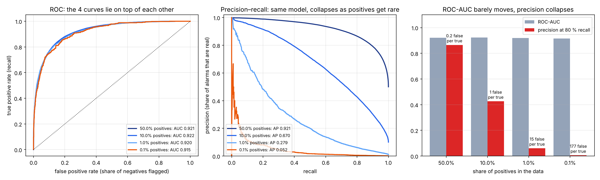
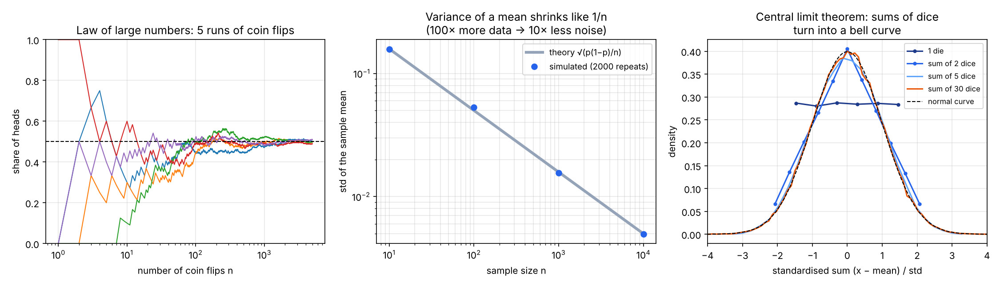
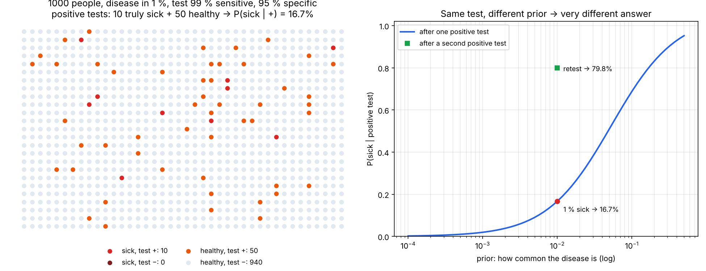

# 06 · Probability, Bayes & why ROC-AUC lies on imbalanced data

🇸🇰 [Slovenská verzia](README.sk.md)

## TL;DR
Three small simulations (fixed seed, every number below comes from `results.json`):
- **Variance of a mean shrinks like 1/n.** Simulated standard deviation of a coin-flip mean: 0.157 → 0.0049 for n = 10 → 10 000 (theory 0.158 → 0.0050).
- **Bayes:** a test that is 99 % sensitive and 95 % specific, for a disease 1 % of people have. After a positive test the chance of being sick is only **16.7 %** (1 million simulated people: 16.5 %). A second positive test raises it to **79.8 %**.
- **ROC-AUC on imbalanced data:** the *same* classifier scores ROC-AUC ≈ 0.92 whether 50 % or 0.1 % of the data are positives. Meanwhile the share of its alarms that are real (precision at 80 % recall) falls from **87 % to 0.6 %**: 177 false alarms for every real one.



## Problem
The roadmap's goal for this step: *"explain why ROC-AUC lies on imbalanced data"*. The next project (P2, customer churn) is a classification problem where only a minority of customers leave. Choosing the wrong metric there means choosing the wrong model. To explain it properly I need three pieces of probability first:
1. what a distribution, a mean and a variance are, and why more data means less noise;
2. Bayes' rule: how a base rate (prior) changes the meaning of a positive result;
3. what ROC and precision–recall curves actually measure.

Source: StatQuest (YouTube), episodes on probability vs likelihood, Bayes, ROC & AUC.

## How it works

### 1. Distributions, mean and variance (`coin_running_means`, `std_of_mean`, `dice_sums`)
- A **distribution** says how likely each outcome is. A fair coin: heads 0.5, tails 0.5. A die: each face 1/6.
- The **mean** (expected value) is the long-run average; the **variance** is the average squared distance from the mean, so it measures spread.
- **Law of large numbers:** the share of heads wanders a lot for the first flips, then settles at 0.5 (left plot).
- **Variance of a mean = σ² / n.** If one flip has variance p(1−p) = 0.25, the mean of n flips has variance 0.25 / n, so its standard deviation is 0.5 / √n. 100× more data gives only 10× less noise. This is why a test set of 100 examples can't tell 0.80 from 0.83 accuracy.
- **Central limit theorem:** a sum of many independent things looks like a normal (bell) curve, whatever one thing looks like. One die is flat; the sum of 30 dice is a bell curve (right plot). Simulated mean and variance of 30 dice: 105.00 and 87.46 (theory 105 and 87.5).



### 2. Bayes' rule (`bayes_experiment`)
```
P(sick | +) = P(+ | sick) · P(sick) / P(+)
            = 0.99 · 0.01 / (0.99 · 0.01 + 0.05 · 0.99) = 0.167
```
The easiest way to see it is with 1000 people (left plot): 10 are sick and almost all of them test positive. But 5 % of the 990 healthy ones *also* test positive, which is about 50 people. So out of ~60 positive tests only ~10 are really sick.

- The test is not bad; the **prior** (1 %) is small. The right plot shows the same test for different priors: at 10 % prevalence a positive means 69 % sick, at 0.1 % only 2 %.
- **Updating:** after one positive test your new prior is 16.7 %. A second, independent positive test gives 79.8 % (simulated 79.3 %). Today's posterior is tomorrow's prior.



### 3. ROC-AUC vs precision–recall (`imbalance_experiment`)
A classifier gives every example a score; above a threshold we say "positive". Here the model is fixed: negatives get scores from N(0, 1), positives from N(2, 1). Only the share of positives changes: 50 %, 10 %, 1 %, 0.1 % of 400 000 examples.

- **ROC curve:** true positive rate (recall: share of positives we catch) against false positive rate (share of *negatives* we wrongly flag). Both are computed *within* one class, so they don't care how big the classes are. ROC-AUC = probability that a random positive gets a higher score than a random negative. For this model it is 0.92 at every imbalance.
- **Precision:** share of alarms that are real = TP / (TP + FP). It mixes the two classes. With 0.1 % positives, even a 10 % false positive rate on 399 600 negatives is about 40 000 false alarms against a few hundred real ones.

| Positives | ROC-AUC | PR-AUC (AP) | Precision at 80 % recall | False alarms per true alarm | Accuracy of "always say no" |
|---|---|---|---|---|---|
| 50 % | 0.921 | 0.921 | 0.866 | 0.2 | 50.0 % |
| 10 % | 0.922 | 0.670 | 0.427 | 1.3 | 90.0 % |
| 1 % | 0.920 | 0.279 | 0.061 | 15.3 | 99.0 % |
| 0.1 % | 0.915 | 0.052 | 0.006 | 177.0 | 99.9 % |

**Why ROC-AUC "lies":** it answers "can the model rank positives above negatives?", and the answer really doesn't change. But on imbalanced data the question that matters is usually "when the model raises an alarm, is it real?", and that is precision, which ROC ignores. Accuracy is even worse: "always say no" is 99.9 % accurate and useless.

**What to do in P2:** report precision–recall (PR-AUC / average precision) next to ROC-AUC, always compare against the base rate (a random model has PR-AUC = share of positives), and choose the threshold from the costs (how expensive is a missed churner vs a wasted retention offer).

## Results
| Experiment | Number | Check |
|---|---|---|
| Std of a coin-flip mean, n = 10 000 | 0.0049 | theory 0.0050 |
| Sum of 30 dice, variance | 87.46 | theory 87.5 |
| P(sick \| +), 1 % prior | 16.5 % simulated | 16.7 % formula |
| P(sick \| +, +) | 79.3 % simulated | 79.8 % formula |
| ROC-AUC, 50 % → 0.1 % positives | 0.921 → 0.915 | barely moves |
| Precision at 80 % recall, 50 % → 0.1 % | 0.866 → 0.006 | collapses |

## 🏎️ On the cars
Crashes are naturally rare, so this step fits the cars well. Cars with a random `aggression` and noisy steering drive 10 training and 10 unseen test tracks. For every frame the question is *"will this car crash within the next second?"*. Only 6.3 % of test frames are "yes". A logistic regression on the 8 sensors reaches **ROC-AUC 0.910**, which looks excellent. But to catch 80 % of crashes only **25 % of its alarms are real (3 false alarms per real one)**, and "always say safe" is 93.7 % accurate. In the GIF a red ring is an alarm before a real crash, an orange ring is a false alarm.


Full chapter: [Racing Lab · ch. 06](https://github.com/kavicka/05-racing-lab/blob/main/README.md#ch-06--predicting-rare-crashes) · code: [`chapters/ch06_crash_risk.py`](https://github.com/kavicka/05-racing-lab/blob/main/chapters/ch06_crash_risk.py)

## What I learned
- More data reduces noise only by √n; small test sets give noisy metrics.
- A positive result means little without the base rate. Always ask "out of how many?".
- ROC-AUC measures ranking and ignores class sizes. On rare positives, look at precision–recall and at false alarms per real one.
- "Accuracy" on imbalanced data mostly measures the imbalance.

## Run it
```bash
uv sync
uv run python probability.py   # simulations → results.json (prints the tables)
uv run python plot.py          # assets/distributions.png, bayes.png, roc_vs_pr.png
```

## Limitations
- The classifier in part 3 is synthetic (two normal distributions), chosen so that ROC-AUC is exactly the same at every imbalance. Real models are messier, but the effect is the same.
- The test in part 2 assumes the two tests are independent given the true state; real retests are often correlated, so 79.8 % is an upper bound.
