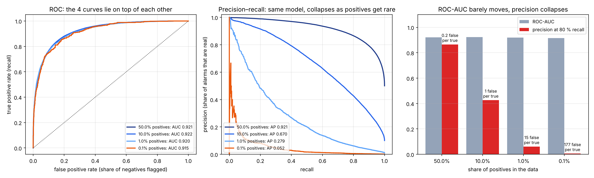
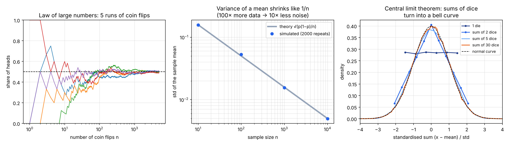
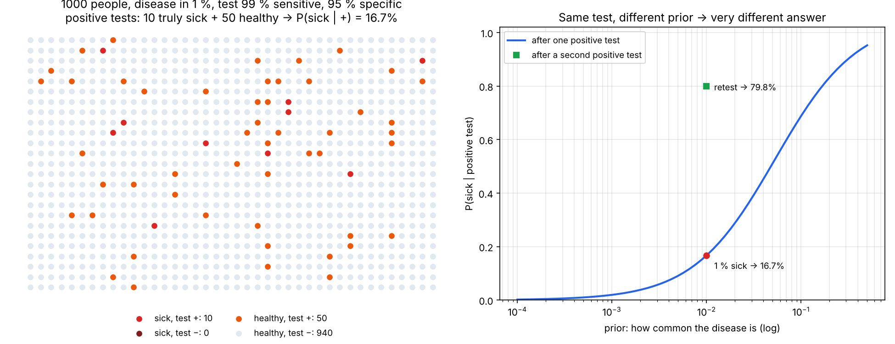

# 06 · Pravdepodobnosť, Bayes a prečo ROC-AUC klame pri nevyvážených dátach

🇬🇧 [English version](README.md)

## TL;DR
Tri malé simulácie (pevný seed, každé číslo nižšie pochádza z `results.json`):
- **Rozptyl priemeru klesá ako 1/n.** Simulovaná smerodajná odchýlka priemeru hodov mincou: 0,157 → 0,0049 pre n = 10 → 10 000 (teória 0,158 → 0,0050).
- **Bayes:** test, ktorý je na 99 % citlivý a na 95 % špecifický, pre chorobu, ktorú má 1 % ľudí. Po pozitívnom teste je šanca, že si chorý, len **16,7 %** (simulácia na 1 milióne ľudí: 16,5 %). Druhý pozitívny test ju zvýši na **79,8 %**.
- **ROC-AUC pri nevyvážených dátach:** *ten istý* klasifikátor má ROC-AUC ≈ 0,92 bez ohľadu na to, či je pozitívnych 50 % alebo 0,1 % dát. Pritom podiel jeho poplachov, ktoré sú skutočné (precision pri 80 % recall), klesne z **87 % na 0,6 %**: 177 falošných poplachov na každý skutočný.



## Najprv jednoducho
Predstav si systém, ktorý upozorňuje na zriedkavú udalosť: chorobu, podvod alebo nabúranie auta. Aj celkom dobrý systém môže vyvolať veľa falošných poplachov, pretože ľudí alebo situácií bez udalosti je omnoho viac. **Táto úloha skúma, čo vtedy znamená pozitívny výsledok a ktorým číslam pri hodnotení modelu veriť.**

Skript najprv simuluje hody mincou a kockami, aby ukázal, prečo sa pri väčšom množstve dát priemer menej mení. Potom počíta príklad zdravotného testu: zo 1 000 ľudí je chorých asi 10, ale falošný pozitívny výsledok dostane aj približne 50 zdravých. Pozitívny test preto znamená len asi 17 % pravdepodobnosť choroby pri zvolených podmienkach.

Nakoniec skript nechá **ten istý** klasifikátor hodnotiť dáta, v ktorých je pozitívnych čoraz menej. Graf ROC-AUC ostáva podobný, no podiel skutočných prípadov medzi poplachmi prudko klesá. Preto pri zriedkavých udalostiach sledujeme aj **precision**: „koľko z mojich poplachov bolo správnych?“ Tieto simulácie pripravujú výber metrík v projekte predpovedania odchodu zákazníkov.

## Problém
Cieľ tohto kroku podľa roadmapy: *„vysvetliť, prečo ROC-AUC klame pri nevyvážených dátach“*. Ďalší projekt (P2, odchod zákazníkov) je klasifikácia, kde odíde len menšina zákazníkov. Zlá metrika tam znamená výber zlého modelu. Aby som to vedel poriadne vysvetliť, potrebujem najprv tri kúsky pravdepodobnosti:
1. čo je rozdelenie, priemer a rozptyl, a prečo viac dát znamená menej šumu;
2. Bayesovo pravidlo: ako základná početnosť (prior) mení význam pozitívneho výsledku;
3. čo naozaj merajú krivky ROC a precision–recall.

Zdroj: StatQuest (YouTube), diely o pravdepodobnosti vs vierohodnosti, Bayesovi, ROC a AUC.

## Ako to funguje

### 1. Rozdelenia, priemer a rozptyl (`coin_running_means`, `std_of_mean`, `dice_sums`)
- **Rozdelenie** hovorí, aký pravdepodobný je každý výsledok. Férová minca: hlava 0,5, znak 0,5. Kocka: každá stena 1/6.
- **Priemer** (stredná hodnota) je dlhodobý priemer; **rozptyl** je priemerná štvorcová vzdialenosť od priemeru, teda meria rozptýlenosť.
- **Zákon veľkých čísel:** podiel hláv pri prvých hodoch veľmi skáče, potom sa ustáli na 0,5 (ľavý graf).
- **Rozptyl priemeru = σ² / n.** Ak má jeden hod rozptyl p(1−p) = 0,25, priemer n hodov má rozptyl 0,25 / n, takže jeho smerodajná odchýlka je 0,5 / √n. 100× viac dát dá len 10× menej šumu. Preto testovacia sada so 100 príkladmi nerozlíši presnosť 0,80 od 0,83.
- **Centrálna limitná veta:** súčet veľa nezávislých vecí vyzerá ako normálne (zvonovité) rozdelenie, nech jedna vec vyzerá akokoľvek. Jedna kocka je plochá; súčet 30 kociek je zvon (pravý graf). Simulovaný priemer a rozptyl 30 kociek: 105,00 a 87,46 (teória 105 a 87,5).



### 2. Bayesovo pravidlo (`bayes_experiment`)
```
P(chorý | +) = P(+ | chorý) · P(chorý) / P(+)
             = 0,99 · 0,01 / (0,99 · 0,01 + 0,05 · 0,99) = 0,167
```
Najľahšie sa to ukáže na 1000 ľuďoch (ľavý graf): 10 je chorých a takmer všetci majú pozitívny test. Ale 5 % z 990 zdravých má pozitívny test *tiež*, to je asi 50 ľudí. Takže z ~60 pozitívnych testov je naozaj chorých len ~10.

- Test nie je zlý; malý je **prior** (1 %). Pravý graf ukazuje ten istý test pri rôznych prioroch: pri 10 % chorých znamená pozitívny výsledok 69 % šancu, pri 0,1 % len 2 %.
- **Aktualizácia:** po jednom pozitívnom teste je tvoj nový prior 16,7 %. Druhý, nezávislý pozitívny test dá 79,8 % (simulácia 79,3 %). Dnešný posterior je zajtrajší prior.



### 3. ROC-AUC vs precision–recall (`imbalance_experiment`)
Klasifikátor dá každému príkladu skóre; nad prahom povieme „pozitívny“. Model je tu pevný: negatívne príklady majú skóre z N(0, 1), pozitívne z N(2, 1). Mení sa len podiel pozitívnych: 50 %, 10 %, 1 %, 0,1 % zo 400 000 príkladov.

- **ROC krivka:** true positive rate (recall: koľko pozitívnych zachytíme) proti false positive rate (koľko *negatívnych* omylom označíme). Obe sa počítajú *v rámci* jednej triedy, takže ich nezaujíma, aké veľké sú triedy. ROC-AUC = pravdepodobnosť, že náhodný pozitívny príklad dostane vyššie skóre než náhodný negatívny. Pre tento model je 0,92 pri každej nevyváženosti.
- **Precision:** podiel poplachov, ktoré sú skutočné = TP / (TP + FP). Mieša obe triedy. Pri 0,1 % pozitívnych aj 10 % false positive rate na 399 600 negatívnych znamená asi 40 000 falošných poplachov proti pár stovkám skutočných.

| Pozitívnych | ROC-AUC | PR-AUC (AP) | Precision pri 80 % recall | Falošných poplachov na jeden skutočný | Presnosť „vždy povedz nie“ |
|---|---|---|---|---|---|
| 50 % | 0,921 | 0,921 | 0,866 | 0,2 | 50,0 % |
| 10 % | 0,922 | 0,670 | 0,427 | 1,3 | 90,0 % |
| 1 % | 0,920 | 0,279 | 0,061 | 15,3 | 99,0 % |
| 0,1 % | 0,915 | 0,052 | 0,006 | 177,0 | 99,9 % |

**Prečo ROC-AUC „klame“:** odpovedá na otázku „vie model zoradiť pozitívne nad negatívne?“, a tá odpoveď sa naozaj nemení. Pri nevyvážených dátach je však dôležitá otázka zvyčajne „keď model spustí poplach, je skutočný?“, a to je precision, ktorú ROC ignoruje. Presnosť (accuracy) je ešte horšia: „vždy povedz nie“ má 99,9 % a je nanič.

**Čo robiť v P2:** reportovať precision–recall (PR-AUC / average precision) vedľa ROC-AUC, vždy porovnať so základnou početnosťou (náhodný model má PR-AUC = podiel pozitívnych) a prah vybrať podľa nákladov (koľko stojí prehliadnutý odchádzajúci zákazník vs zbytočná ponuka na udržanie).

## Výsledky
| Experiment | Číslo | Kontrola |
|---|---|---|
| Smerodajná odchýlka priemeru hodov mincou, n = 10 000 | 0,0049 | teória 0,0050 |
| Súčet 30 kociek, rozptyl | 87,46 | teória 87,5 |
| P(chorý \| +), prior 1 % | 16,5 % simulácia | 16,7 % vzorec |
| P(chorý \| +, +) | 79,3 % simulácia | 79,8 % vzorec |
| ROC-AUC, 50 % → 0,1 % pozitívnych | 0,921 → 0,915 | takmer sa nehne |
| Precision pri 80 % recall, 50 % → 0,1 % | 0,866 → 0,006 | zrúti sa |

## 🏎️ Na autíčkach
Nabúrania sú prirodzene zriedkavé, takže tento krok na autíčka sedí. Autá s náhodnou `aggression` a zašumeným zatáčaním jazdia po 10 tréningových a 10 nevidených testovacích tratiach. Pri každej snímke je otázka *„nabúra toto auto v nasledujúcej sekunde?“*. Len 6,3 % testovacích snímok je „áno“. Logistická regresia na 8 senzoroch dosiahne **ROC-AUC 0,910**, čo vyzerá výborne. Ale aby zachytila 80 % nabúraní, je skutočných len **25 % jej poplachov (3 falošné na jeden skutočný)**, a „vždy povedz bezpečné“ má presnosť 93,7 %. V GIFe je červený krúžok poplach pred skutočným nabúraním, oranžový je falošný poplach.


Celá kapitola: [Racing Lab · kap. 06](https://github.com/kavicka/05-racing-lab/blob/main/README.sk.md#kap-06--predpoveď-zriedkavých-nabúraní) · kód: [`chapters/ch06_crash_risk.py`](https://github.com/kavicka/05-racing-lab/blob/main/chapters/ch06_crash_risk.py)

## Čo som sa naučil
- Viac dát zníži šum len o √n; malé testovacie sady dávajú zašumené metriky.
- Pozitívny výsledok bez základnej početnosti veľa neznamená. Vždy sa pýtaj „z koľkých?“.
- ROC-AUC meria zoradenie a ignoruje veľkosti tried. Pri zriedkavých pozitívnych sleduj precision–recall a počet falošných poplachov na jeden skutočný.
- „Presnosť“ pri nevyvážených dátach meria hlavne nevyváženosť.

## Spustenie
```bash
uv sync
uv run python probability.py   # simulácie → results.json (vypíše tabuľky)
uv run python plot.py          # assets/distributions.png, bayes.png, roc_vs_pr.png
```

## Obmedzenia
- Klasifikátor v časti 3 je syntetický (dve normálne rozdelenia), zvolený tak, aby ROC-AUC bolo pri každej nevyváženosti rovnaké. Skutočné modely sú zložitejšie, ale efekt je rovnaký.
- Test v časti 2 predpokladá, že dva testy sú nezávislé pri danom skutočnom stave; skutočné opakované testy často korelujú, takže 79,8 % je horná hranica.
